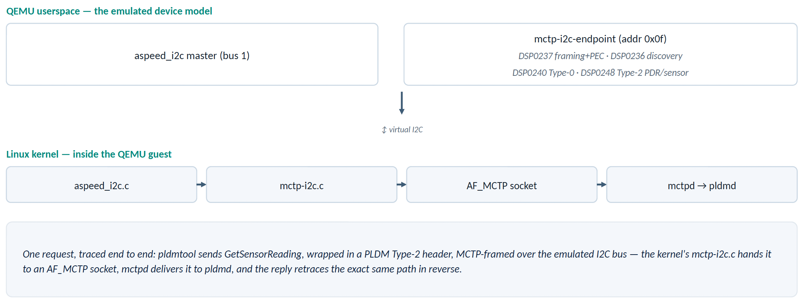

# meta-johnblue Architecture

This document explains how the `meta-johnblue` QEMU environment works. A QEMU I2C device
plays the PLDM terminus, and real OpenBMC software on the emulated AST2600 talks to it.
For build, run, and verify steps, see [README.md](README.md).

Start with [The Big Picture](#the-big-picture). Figure 1 shows every component and the
layer it belongs to. The later figures follow one message through that map, and the
remaining sections are reference material.

- [The Big Picture](#the-big-picture): layer map, frame layout, confusing names
- [Boot Sequence](#boot-sequence): which service starts what
- [Data Flow](#data-flow): EID discovery, a runtime query, the kernel receive path
- [pldmd vs pldmtool](#pldmd-vs-pldmtool): what pldmd is for, and where it stops today
- [Implementation Status](#implementation-status): what is real, simulated, missing
- [QEMU I2C Device Model](#qemu-i2c-device-model): device facts, protocol coverage, response pacing
- [QEMU Machine and Patch](#qemu-machine-and-patch)
- [Source Code Walkthrough](#source-code-walkthrough): `mctp_i2c_endpoint.c` function by function
- [Project Structure](#project-structure)

---

## The Big Picture

### Figure 1: every component and its layer

```
         BMC: Linux guest, EID 8                       QEMU device mctp-i2c-endpoint: EID 10, bus 1, addr 0x0f
+========================================+            +=======================================================+
| L7 Application                         |            | (none)                                                |
| bmcweb (Redfish) reads D-Bus sensors   |            |                                                       |
| that pldmd creates: NOT WORKING YET    |            |                                                       |
+----------------------------------------+            +-------------------------------------------------------+
| L6 PLDM                                | PLDM msg   | handle_pldm_base()  PLDM Type 0 (Base)                |
| pldmd (platform-mc), pldmtool          |<---------->| handle_pldm_pmc()   PLDM Type 2 (PMC) + pdr_repo[]    |
+----------------------------------------+            +-------------------------------------------------------+
| L5 MCTP control                        | MCTP ctrl  | handle_mctp_control()                                 |
| mctpd (bus owner)                      |<---------->| SetEID, GetEID, GetVersion, GetMsgTypes               |
+----------------------------------------+            +---------------------------+---------------------------+
| L4 MCTP transport (DSP0236)            |            | RX: process_mctp_frame()  | TX: build_mctp_frame()    |
| kernel net/mctp/ + AF_MCTP sockets     |            |   read dst/src EID, tag   |   write ver, EIDs,        |
| EIDs, tags, routing, socket demux      | MCTP hdr   |   dispatch on msg type    |   SOM|EOM|tag             |
|                                        |<---------->|   (then on PLDM type)     |                           |
+----------------------------------------+            |  - - - - - - - - - - - -  |  - - - - - - - - - - - -  |
| L3 MCTP-over-SMBus binding (DSP0237)   |            |   check cmd 0x0F and      |   write cmd 0x0F,         |
| drivers/net/mctp/mctp-i2c.c            |            |   byte_count              |   byte_count, src addr    |
| netdev mctpi2c1, I2C slave at 0x10     | SMBus+PEC  |   PEC: not verified       |   crc8_smbus() -> PEC     |
| add/check SMBus header and PEC         |<---------->|                           |                           |
+----------------------------------------+            +---------------------------+---------------------------+
| L2 I2C controller driver               |            | mctp_i2c_ep_send/_event() | mctp_i2c_resp_bh()        |
| drivers/i2c/busses/i2c-aspeed.c        | I2C bytes  |   bytes -> rx_buf;        |   1 byte per 20 ms tick,  |
| byte mode: 1 interrupt per byte        |<---------->|   FINISH -> process...()  |   master write to 0x10    |
+----------------------------------------+------------+---------------------------+---------------------------+
| L1 wire: QEMU hw/i2c/aspeed_i2c.c (emulated AST2600 I2C controller) + QEMU I2C bus 1                        |
|   request:  BMC is master, writes to 0x0f      response: device is master, writes to 0x10                   |
+=============================================================================================================+
```

How to read it:

- **L1 to L7 are this document's labels.** They exist so the two sides can be compared
  row by row. No DMTF spec defines them.
- **Horizontal arrows are logical.** Each layer "talks" to the same layer on the other
  side, but bytes only physically cross at L1. A request goes down the BMC column, across
  the wire, and up the device column. A response takes the reverse path.
- **The two sides are split differently.** On the BMC, each layer is a separate kernel
  module or process. The device is one C file, and its functions are split by
  **direction** (receive or transmit), not by layer:
  - `process_mctp_frame()` is the device's entire receive path for L3 and L4. It also
    decides which L5/L6 handler gets the message.
  - `build_mctp_frame()` is the entire transmit path for L4 and L3. Every handler calls
    it with a finished payload.
  - `crc8_smbus()` is the only piece that belongs to a single layer (L3, the PEC).

  The dotted line inside those two functions shows where the L3/L4 boundary falls.
  [Figure 2](#figure-2-one-frame-byte-by-byte) shows the exact bytes on each side of it.
- **Both directions are I2C master writes.** The BMC writes requests to the device at
  `0x0f`. The device then becomes bus master and writes the response to the BMC at
  `0x10`. Nobody ever does an I2C read. That is why the BMC must listen as an I2C slave
  at `0x10`, and why the device needs its own transmit path at L2.
- **mctpd lives only at L5.** It assigns EIDs and sets up routes. Runtime PLDM traffic
  from `pldmd` or `pldmtool` uses its own AF_MCTP sockets and never passes through mctpd.

### Figure 2: one frame, byte by byte

Every request and response on the wire has this shape. `[n]` is the index in the
device's `rx_buf`/`resp_buf`. The `addr` byte is the I2C address phase: QEMU's I2C core
consumes it before the device sees any data, but the PEC still covers it.

```
              addr    [0]     [1]      [2]     [3]   [4]   [5]     [6]     [7]        [8]...       last
          +---------+------+-------+---------+-----+-----+-----+---------+------+----------------+-----+
          |   dest  | cmd  |  byte |   src   | hdr | dst | src | SOM EOM | msg  |    message     | PEC |
          | addr<<1 | 0x0F | count | addr<<1 | ver | EID | EID |  TO tag | type |      body      |     |
          +---------+------+-------+---------+-----+-----+-----+---------+------+----------------+-----+
           <---------- L3 DSP0237 ----------> <------- L4 DSP0236 ------> <------ L5 / L6 ------>   L3

request:       1e      0f      09       21      01    0a    08      c8      01       80 00 02       4e
response:      20      0f      0b       1f      01    08    0a      c0      01    00 00 02 00 01    de
```

The two example rows are a `pldmtool base GetTID -m 10` exchange, assuming MCTP tag 0
and PLDM instance ID 0. The request goes BMC (EID 8, I2C `0x10`) to device (EID 10, I2C
`0x0f`). The response swaps the addresses and EIDs, clears the tag-owner bit (`c8` to
`c0`), and adds completion code `00` and TID `01`.

Who handles each part of the frame:

| Bytes | Layer | BMC kernel | Device receive (`process_mctp_frame`) | Device transmit |
|---|---|---|---|---|
| `addr` | L2 | `i2c-aspeed.c` addresses `0x0f`, or matches its slave address `0x10` | QEMU I2C core routes by address | `i2c_start_send_async(0x10)` in `mctp_i2c_resp_bh()` |
| `[0]`–`[2]` | L3 | `mctp-i2c.c` builds them on TX and checks `cmd` and `byte_count` on RX | checks `[0] == 0x0F` and that `byte_count` fits; ignores `[2]` | `build_mctp_frame()` |
| `[3]`–`[6]` | L4 | `net/mctp/` builds them on TX; on RX checks the destination EID and matches the tag | reads `[4]`–`[6]`; ignores the version, SOM/EOM, and whether `dst EID` is its own | `build_mctp_frame()`: swaps EIDs, sets SOM=EOM=1 and TO=0, echoes the tag |
| `[7]` | L4/L5 boundary | `net/mctp/` uses the type and tag to choose the receiving socket | picks the handler: `0x00` control, `0x01` PLDM (then reads the PLDM type at `[9]`) | each `handle_*()` writes its own type byte as `payload[0]` |
| `[8]`... | L5/L6 | `mctpd`, `pldmd`, `pldmtool` | `handle_mctp_control()`, `handle_pldm_base()`, `handle_pldm_pmc()` | same handlers |
| `last` | L3 | `mctp-i2c.c` computes the PEC on TX, and on RX drops the frame if it is wrong | **not verified**, only excluded from the length | `crc8_smbus()` over `addr` + `[0]`...`[n]` |

Message body layout after `[7]`:

- **MCTP control** (`[7] = 0x00`): `[8]` = Rq bit + instance ID, `[9]` = command, `[10]`... = data
- **PLDM** (`[7] = 0x01`): `[8]` = Rq bit + instance ID, `[9]` = header version + PLDM type, `[10]` = command, `[11]`... = data

### Names that are easy to mix up

| Name | Meaning 1 | Meaning 2 |
|---|---|---|
| `aspeed_i2c` | QEMU `hw/i2c/aspeed_i2c.c`: the **emulated controller hardware** (L1) | Linux `drivers/i2c/busses/i2c-aspeed.c`: the **BMC's driver** for that controller (L2) |
| `0x0f` | the device's **I2C address** | the DSP0237 **command code** in byte `[0]` of every frame. The match is a coincidence |
| "Type 0" | **MCTP** message type 0 = MCTP Control | **PLDM** type 0 = PLDM Base. A PLDM Base message is MCTP type 1 that carries PLDM type 0 |
| `0x10` vs `0x0f` | `0x10` = the BMC's own I2C slave address, where responses arrive | `0x0f` = the device's I2C address, where requests go |
| EID 10 vs TID 1 | EID 10 = the device's MCTP address, assigned by mctpd | TID 1 = the device's PLDM Terminus ID, hard-coded in the device |

---

## Boot Sequence

### Figure 3: service start order and layer

```
 kernel boot           i2c-aspeed.c probes bus 1. The DTS patch adds             L2
     |                 &i2c1 { mctp-controller; }. No mctpi2c1 exists yet.
     v
 mctpd.service         bus-owner mode (mctpd.conf). Owns D-Bus name              L5
     |                 au.com.codeconstruct.MCTP1.
     v
 mctp-setup-i2c        1. writes "mctp-i2c-interface 0x10" to i2c-1/new_device   L3
   .service               -> mctp-i2c.c probes, registers I2C slave 0x10 and,
     |                       because i2c1 has mctp-controller, creates mctpi2c1
     |                 2. mctp link set mctpi2c1 up; mctp addr add 8             L4
     v
 mctp-discover-        busctl AssignEndpointStatic(phys addr 0x0f, EID 10)       L5
   terminus.service       -> mctpd talks to the device over I2C (Figure 4)       L5 to L1
     |                    -> mctpd publishes endpoint 10 on D-Bus
     v
 pldmd.service         finds endpoint 10 on D-Bus, starts platform-mc (Figure 6) L6
```

Two details people often get wrong:

- **The DTS property alone does not create `mctpi2c1`.** The `mctp-controller` property
  only marks bus 1 as allowed for MCTP. The kernel creates the netdev once an
  `mctp-i2c-interface` client is probed on that bus. This DTS has no such client node,
  so `mctp-setup-i2c.service` creates the client at `0x10` through `new_device`.
- **The retry loop in `mctp-discover-terminus.service` is intentional.** mctpd only
  exposes `.../interfaces/mctpi2c1` on D-Bus after it sees the new link through netlink,
  and that can lag a moment behind `mctp-setup-i2c.service` finishing.

---

## Data Flow

### Figure 4: EID discovery at boot

```
 discover-svc         mctpd               BMC kernel                   QEMU device
      |                 |                     |                              |
      |---(1) D-Bus --->|                     |                              |
      |                 |---(2) socket ------>|                              |
      |                 |                     |---(3) write to 0x0f -------->|
      |                 |                     |                              | (4) process,
      |                 |                     |<--(5) write to 0x10 ---------|     build reply
      |                 |<--(6) socket -------|                              |
      |                 |   (7) repeat (2)-(6) for GetMsgTypes, GetUUID      |
      |<--(8) D-Bus ----|                     |                              |
```

1. `mctp-discover-terminus.service` calls `AssignEndpointStatic([0x0f], 10)` on mctpd
   over D-Bus.
2. mctpd sends an MCTP Control `SetEndpointID(10)` on an AF_MCTP socket. The device has
   no EID yet, so mctpd addresses it by interface (`mctpi2c1`) and physical address
   `0x0f`.
3. `net/mctp/` adds the MCTP header, and `mctp-i2c.c` adds the DSP0237 header and PEC.
   `i2c-aspeed.c` then does a master write to `0x0f`.
4. On the device, `mctp_i2c_ep_send()` collects the bytes. On `I2C_FINISH`,
   `process_mctp_frame()` hands the message to `handle_mctp_control()`, which stores EID
   10 and calls `build_mctp_frame()`.
5. `mctp_i2c_resp_bh()` master-writes the response to `0x10`, one byte per 20 ms.
6. `i2c-aspeed.c` passes each byte to `mctp-i2c.c`, which checks the frame (see
   [Inside the BMC kernel](#inside-the-bmc-kernel-from-a-byte-interrupt-to-a-socket)).
   `net/mctp/` then matches the tag and wakes mctpd.
7. mctpd repeats steps 2 to 6 for `GetMessageTypeSupport` (the device answers types
   `0x00` and `0x01`) and `GetEndpointUUID`. The device answers "unsupported" to the UUID
   request, and mctpd continues anyway.
8. mctpd adds the route and neighbour entry for EID 10, publishes an endpoint D-Bus
   object that lists its message types, and replies to `busctl`.

### Figure 5: a runtime query from pldmtool

```
 pldmtool                  BMC kernel                    QEMU device
     |                         |                              |
     |---(1) socket ---------->|                              |
     |                         |---(2) write to 0x0f -------->|
     |                         |                              | (3) handle_pldm_pmc():
     |                         |<--(4) write to 0x10 ---------|     sensor 1 = 42
     |<--(5) socket -----------|                              |
```

1. `pldmtool platform GetSensorReading -m 10 -i 1 -r 0` opens its own AF_MCTP socket and
   sends a PLDM message (MCTP type 1) to EID 10. mctpd is not involved, because the
   kernel already knows the route from discovery.
2. The kernel frames the message and writes it to `0x0f`, as in Figure 4.
3. `process_mctp_frame()` sees MCTP type 1 and PLDM type 2, so it calls
   `handle_pldm_pmc()`. That handler reads sensor `0x0001` (42 °C) and calls
   `build_mctp_frame()`.
4. The device sends the paced master write to `0x10`.
5. The kernel checks the frame, matches the tag to pldmtool's socket, and pldmtool prints
   the JSON result.

### Inside the BMC kernel: from a byte interrupt to a socket

This is step 6 of Figure 4 and step 5 of Figure 5, in detail:

```
QEMU hw/i2c/aspeed_i2c.c       raises the bus-1 interrupt, once per byte
        |
        v
drivers/i2c/busses/i2c-aspeed.c
        aspeed_i2c_slave_irq() -> i2c_slave_event(WRITE_REQUESTED / WRITE_RECEIVED / STOP)
        It calls whoever registered as I2C slave at 0x10. It never reads mctp-controller.
        |
        v
drivers/net/mctp/mctp-i2c.c
        mctp_i2c_slave_cb(): append each byte to rx_buffer
        on STOP, mctp_i2c_recv(): check cmd == 0x0F, byte_count, PEC
                                  -> strip SMBus header -> netif_rx()
        |
        v
net/mctp/  (kernel MCTP core, Linux 5.15+)
        check dst EID is local (8), reassemble if needed, find the socket:
          response (TO=0) -> the socket that sent the request with this tag
          request  (TO=1) -> the socket bound to this message type
        |
        +--> mctpd     (MCTP control, type 0)
        +--> pldmtool / pldmd   (PLDM, type 1)
```

`i2c-aspeed.c` never talks to mctpd directly. It hands each byte to `mctp-i2c.c`.
`mctp-i2c.c` assembles a packet and passes it to the kernel MCTP core, and the core
delivers it to a socket. PLDM messages go to pldmd or pldmtool, never to mctpd.

---

## pldmd vs pldmtool

The data-flow figures above use `pldmtool`. `pldmd` is the component that is supposed to
bring the device's sensors into Redfish.

### Figure 6: what pldmd's platform-mc pipeline is meant to do

```
                                    +-------------------------------------+
                                    | bmcweb (Redfish)                    |  L7
                                    +------------------^------------------+
                                                       | D-Bus read
                                    +------------------+------------------+
                                    | D-Bus sensor objects                |  L7
                                    | /xyz/openbmc_project/sensors/...    |
                                    +------------------^------------------+
                                                       | (5) create, update Value
+-------------------------+         +------------------+------------------+
| mctpd                   |   (1)   | pldmd (platform-mc)                 |  L6
|  D-Bus endpoint object  |-------->|  MctpDiscovery      (1) add EID 10  |
|  EID 10, msg types 0, 1 |  D-Bus  |  TerminusManager    (2) Base init   |
+-------------------------+         |  PlatformManager    (3) PDR walk    |
           L5                       |  SensorManager      (4) polling     |
                                    +------------------+------------------+
                                                       | (2)(3)(4) PLDM over AF_MCTP
                                                       v
                                 kernel MCTP stack -> I2C -> QEMU device (EID 10)
```

1. **Find the terminus.** `MctpDiscovery` watches mctpd's objects under
   `/au/com/codeconstruct/mctp1`. Endpoint 10 lists message type 1 (PLDM), so pldmd adds
   it as a terminus. mctpd and pldmd are connected through D-Bus, not through MCTP
   packets.
2. **Initialize it.** `TerminusManager` sends `GetTID` and `GetPLDMTypes`. Then, for each
   supported type, it sends `GetPLDMVersion` and `GetPLDMCommands`. The answers fill a
   per-terminus bitmap of supported commands.
3. **Read the PDRs.** `PlatformManager` uses `GetPDRRepositoryInfo` and a series of
   `GetPDR` calls to read the repository. It finds sensor `0x0001` (CPU temperature) and
   sensor `0x0002` (12 V rail).
4. **Poll.** `SensorManager` sends `GetSensorReading` periodically.
5. **Publish.** Each sensor becomes a D-Bus object (`xyz.openbmc_project.Sensor.Value`),
   which bmcweb reads and exposes through Redfish.

| | pldmtool | pldmd |
|---|---|---|
| What it is | CLI, one command per run | long-running daemon |
| Triggered by | you typing a command | mctpd's D-Bus endpoint object appearing |
| What it does | one request, one JSON response | discovery, PDR walk, polling |
| Output | terminal only | D-Bus sensors, which feed Redfish |
| Needs `GetPLDMCommands` | no | yes |
| Status in this project | works | stops before the PDR walk (below) |

When this project says "verified end to end", it means the `pldmtool` path. The `pldmd`
path is the one that would put sensors into Redfish, and it does not work yet.

### Figure 7: where pldmd stops today

```
pldmd platform-mc                       QEMU device (EID 10)      pldmd's reaction
  GetTID                 (Base 0x02) -> TID 1                     ok
  GetPLDMTypes           (Base 0x04) -> types 0 and 2             ok
  GetPLDMVersion  type 0 (Base 0x03) -> 1.1.0                     ok
  GetPLDMCommands type 0 (Base 0x05) -> cc 0x05 unsupported       logs error, bitmap stays all 0
  GetPLDMVersion  type 2 (Base 0x03) -> 1.2.0                     ok
  GetPLDMCommands type 2 (Base 0x05) -> cc 0x05 unsupported       logs error, bitmap stays all 0
  ---------------------------------------------------------------------------------------------
  "does terminus support GetPDR?" -> bitmap says no -> PDR walk skipped, GetPDR never sent
  no PDRs -> no sensors -> no GetSensorReading polling -> no D-Bus sensors -> nothing in Redfish
```

pldmd does not abort at the error. `initMctpTerminus()` logs
`Error : GetPLDMCommands for terminus ID 1, complete code 5.` and keeps going with an
all-zero command bitmap. `PlatformManager` checks that bitmap before each optional step
(`GetPDR`, `GetPDRRepositoryInfo`, `SetEventReceiver`, `EventMessageSupported`, ...).
Because every bit is zero, it skips all of them.

What `journalctl -u pldmd.service` shows at boot, and why. These lines were observed on
a real boot of this image:

| Log line | Source in pldmd | Meaning |
|---|---|---|
| `No associated subtree found for path .../endpoints/10/configured_by` | MCTP discovery | No Entity Manager config for this endpoint. Harmless. |
| `Instance ID expiry for EID '10' ...` then `No response received for query device identifiers for endpoint ID 10` | `fw-update/inventory_manager.cpp` | The firmware-update code sends `QueryDeviceIdentifiers` (PLDM type 5) to every endpoint. The device ignores type 5 (see [Known Gaps](#known-gaps)), so the request times out. Harmless here. |
| `Getting the response code '0x0'` | `host-bmc/host_pdr_handler.cpp` | The host-firmware path sent `GetPLDMVersion` to `host_eid` (10, this device) and got success |
| `Error : GetPLDMCommands for terminus ID 1, complete code 5.` (twice: type 0 and type 2) | platform-mc `TerminusManager` | The gap in Figure 7 |
| `Terminus 1 does not support Event` then `Failed to config event receiver ...` | platform-mc `PlatformManager` | `SetEventReceiver` is skipped because of the empty bitmap. Expected even after the fix, since the device has no events. |
| `Successfully initialized platform manager` | platform-mc | Init finished, but with no PDRs and no sensors |

**Next step to fix it:** implement `GetPLDMCommands` (0x05) in `handle_pldm_base()`. Per
DSP0240, the request is a PLDM type plus a 4-byte version. The response is a completion
code plus a 32-byte bitmap with one bit per command. Advertise only the commands the
device really implements:

- Type 0: `0x02` GetTID, `0x03` GetPLDMVersion, `0x04` GetPLDMTypes, `0x05` GetPLDMCommands
- Type 2: `0x11` GetSensorReading, `0x50` GetPDRRepositoryInfo, `0x51` GetPDR

pldmd checks this bitmap before each step, so an accurate one makes it skip the commands
the device lacks, such as `SetEventReceiver`. The bitmap only has to be truthful; the
device does not need every command. Nothing beyond the PDR walk has been tested yet.

Two more facts about pldmd that are easy to confuse with the pipeline above:

- **`/usr/share/pldm/host_eid` (set to 10 by this layer) is a separate mechanism.**
  `pldmd.cpp` reads it at startup for its older host-firmware code (HostPDRHandler and
  related). platform-mc does not use it; it finds the terminus from mctpd's D-Bus
  objects. Because the value is 10, the host-firmware path also treats this device as
  "the host": at startup it sends `GetPLDMVersion` to EID 10 to check whether the host is
  up, which shows up as `Getting the response code '0x0'` in the log.
- **pldmd can also be a responder.** It answers PLDM requests sent *to* the BMC. This
  device only responds and never sends requests, so that side is unused here.

---

## Implementation Status

The QEMU device is **not a software loopback mock**. Every MCTP/PLDM byte crosses the
emulated I2C bus and goes through the real Linux kernel driver stack. See
[How to Verify](README.md#how-to-verify) for the commands that show this.

### What is real

- **Upstream code, unmodified:** QEMU's AST2600 I2C controller model
  (`hw/i2c/aspeed_i2c.c`), plus the kernel's `i2c-aspeed.c`, `mctp-i2c.c`, and
  `net/mctp/`, plus OpenBMC's `mctpd`, `pldmd`, and `pldmtool`
- **EID assignment:** `SetEndpointID` really crosses the wire (Figure 4). There is no
  static `mctp addr add` for the terminus.
- **pldmtool queries:** `GetTID`, `GetPLDMTypes`, `GetPLDMVersion`, `GetPDR` (both
  sensor records decode fully), and `GetSensorReading` all return correct values

### What is simulated

- **Sensor values:** CPU temperature is always 42 °C and the 12 V rail is always 11.98 V.
  No hwmon driver sits behind them. Only the values are canned; the transport and
  protocol handling are real.
- **Some PDR fields:** `record_change_num`, the CRC-32 in `GetPDR` responses, and a few
  other rarely checked fields are zero or placeholders.

### Known Gaps

- **pldmd does not create D-Bus sensors,** because the device does not implement
  `GetPLDMCommands`. See [Figure 7](#figure-7-where-pldmd-stops-today). This does not
  affect `pldmtool`.
- **The device's receive path is lenient.** `process_mctp_frame()` does not verify the
  PEC, does not check that the destination EID is its own, and ignores SOM/EOM. The BMC
  kernel does all three checks on the other direction.
- **Single-packet messages only.** The device never fragments or reassembles. This works
  because `mctpi2c1`'s MTU is 254 bytes and every message here fits in one packet.
- **Unimplemented MCTP Control commands** return completion code `0x05`: for example,
  `GetEndpointUUID`, which mctpd tolerates.
- **Unsupported PLDM types get no response at all.** `process_mctp_frame()` only
  dispatches PLDM types 0 and 2 (and MCTP message types 0 and 1). For anything else it
  sends nothing, not even an error completion code, so the requester waits for its
  timeout. pldmd's `QueryDeviceIdentifiers` (PLDM type 5) hits this at every boot.

---

## QEMU I2C Device Model

### Device Details

| Property | Value |
|---|---|
| QEMU type name | `mctp-i2c-endpoint` |
| I2C bus | bus 1 (`mctpi2c1` in the BMC kernel) |
| I2C address | `0x0f` (7-bit) |
| Sends responses to | BMC I2C slave address `0x10` |
| Machine name | `ast2600-johnblue` |
| Source file | `hw/i2c/mctp_i2c_endpoint.c` |
| Header file | `include/hw/i2c/mctp_i2c_endpoint.h` |

### Protocol Support

| Protocol | Spec | Commands |
|---|---|---|
| MCTP-over-SMBus framing | DSP0237 | Builds frames with PEC on transmit. On receive, checks command code and byte count (PEC not verified) |
| MCTP Control | DSP0236 | `SetEndpointID`, `GetEndpointID`, `GetMCTPVersionSupport`, `GetMessageTypeSupport` |
| PLDM Base | DSP0240 Type 0 | `GetTID`, `GetPLDMTypes`, `GetPLDMVersion` |
| PLDM PMC | DSP0248 Type 2 | `GetPDRRepositoryInfo`, `GetPDR`, `GetSensorReading` |

`GetPLDMCommands` (PLDM Base 0x05) is **not** implemented. See [Known Gaps](#known-gaps).

### Simulated Sensors

| Sensor ID | Description | Type | Unit | Simulated Value |
|---|---|---|---|---|
| `0x0001` | CPU Temperature | `NumericSensorPDR` | °C (base_unit=2) | 42 °C |
| `0x0002` | 12V Rail Voltage | `NumericSensorPDR` | V (base_unit=5, unitModifier=-2) | 11.98 V (reading=1198) |

### Response Mechanism (Aspeed AST2600 Old-Mode I2C)

This section explains why the device's transmit path (the L2 TX cell in Figure 1) sends
one byte per timer tick.

The BMC kernel drives the AST2600 I2C controller in **old mode** (byte mode). Each byte
the device sends lands in a single-byte hardware register (`I2CD_BYTE_BUF`) and raises
one interrupt. The guest's interrupt handler must read that byte before the next one
overwrites it. The kernel never switches to the DMA-based new mode
(`I2C_CTRL_GLOBAL`/`REG_MODE`) in this configuration.

When the device receives a complete frame (`I2C_FINISH` event), it:

1. Calls `process_mctp_frame()`, which checks the DSP0237/MCTP headers and picks a handler
2. Runs that handler (`handle_mctp_control`, `handle_pldm_base`, or `handle_pldm_pmc`)
3. Has the handler call `build_mctp_frame()`, which adds the headers and PEC
4. Schedules a bottom half (`qemu_bh_schedule`), which starts a `QEMUTimer`-paced state
   machine in `mctp_i2c_resp_bh()`. That machine sends the address phase, then one
   `i2c_send_async()` per timer tick, then `i2c_end_transfer()` one full tick after the
   last byte.

**Why pacing is necessary:** QEMU device callbacks run with the BQL held. A tight loop
that pushes every byte in one call never lets the guest vCPU run in between, so the
kernel's interrupt handler only sees the last byte and the rest of the frame is lost.
Kernel dynamic-debug tracing on `aspeed_i2c_slave_irq()` confirmed this. At 100 µs per
byte, the handler ran only 3 times for a 15-byte response, because most bytes were
overwritten before it was scheduled. At 20 ms per byte on `QEMU_CLOCK_VIRTUAL`, the
guest services every interrupt reliably. Even the largest frame then takes well under a
second, far inside mctpd's 5 s per-message timeout.

The **address phase** (`i2c_start_send_async`) gets its own timer tick and is not sent
back-to-back with byte 0. Both use the same single-byte register. Without a delay, byte
0 overwrites the address before the guest reads it, and the guest misclassifies the
transaction.

---

## QEMU Machine and Patch

### QEMU Machine: `ast2600-johnblue`

`aspeed_ast2600_johnblue.c` defines a new QEMU machine that clones `ast2600-evb` and adds
the MCTP endpoint:

```c
// Places mctp-i2c-endpoint at I2C bus 1 / address 0x0f
i2c_slave_create_simple(aspeed_i2c_get_bus(&soc->i2c, 1),
                        TYPE_MCTP_I2C_ENDPOINT, 0x0f);
```

`johnblue.conf` overrides the inherited QEMU machine:

```bitbake
QB_MACHINE = "-machine ast2600-johnblue"
```

### `0001-hw-add-mctp-i2c-endpoint-and-ast2600-johnblue-machine.patch`

This is the only QEMU patch in the layer. `qemu-system-native_%.bbappend` applies it to
QEMU 10.2.0. It touches 7 files:

| File | Type | Description |
|---|---|---|
| `hw/i2c/mctp_i2c_endpoint.c` | new | Core device model (~965 lines): DSP0237 framing, MCTP Control, PLDM Base, PLDM PMC, 2 sensors, timer-paced response path |
| `include/hw/i2c/mctp_i2c_endpoint.h` | new | `MCTPEndpointState` struct, `TYPE_MCTP_I2C_ENDPOINT` constant |
| `hw/arm/aspeed_ast2600_johnblue.c` | new | Machine `"ast2600-johnblue"`: clones EVB, places `mctp-i2c-endpoint` on bus 1 / addr `0x0f` |
| `hw/i2c/Kconfig` | modified | Adds `config MCTP_I2C_ENDPOINT` (bool, selects I2C) |
| `hw/i2c/meson.build` | modified | Compiles `mctp_i2c_endpoint.c` when `CONFIG_MCTP_I2C_ENDPOINT` is set |
| `hw/arm/Kconfig` | modified | Adds `select MCTP_I2C_ENDPOINT` to `config ASPEED_SOC` |
| `hw/arm/meson.build` | modified | Adds `aspeed_ast2600_johnblue.c` to the aspeed machine list |

The patch is in standard `git format-patch` format. New files use `/dev/null` as the `a/`
side.

Implementation notes:
- Include `qemu/main-loop.h` explicitly for `qemu_bh_new`, `qemu_bh_schedule`, and
  `qemu_bh_delete`. `qemu/osdep.h` does not pull them in.
- The response is a master write to `BMC_I2C_SLAVE_ADDR=0x10`, not a slave read, because
  that is the path the Aspeed old-mode slave interrupt handler expects.

---

## Source Code Walkthrough

The sections above describe *what* the device model does. This section explains *why*
it is built the way it is, function by function, and assumes no prior QEMU device-model
experience. If you have never written a QEMU device, read
[Background Concepts](#background-concepts) first.

### Background Concepts



**QOM (QEMU Object Model).** Every QEMU device is a C "object" with a type name, a state
struct, and lifecycle callbacks (`realize`/`unrealize`). QEMU calls the callbacks
automatically when the device is created or destroyed. You register them in a `TypeInfo`
rather than calling them yourself. That is why `mctp_i2c_ep_realize()` seems to have no
caller in this file: `mctp_i2c_ep_class_init()` wires it up, and QOM invokes it when the
machine file creates the device.

**The BQL (Big QEMU Lock).** QEMU device emulation is essentially single-threaded. The
emulated guest CPU and all device callbacks take turns under one global lock. A device
callback that loops or blocks therefore stops the guest CPU until it returns; the guest
cannot handle its interrupt "meanwhile". A device that needs to spread work over time,
such as sending bytes one at a time and letting the guest react to each, must return to
the main loop between steps. Bottom halves and timers exist for that.

**Bottom halves (BH) and timers.** A QEMU bottom half (`QEMUBH`) is a callback that the
main loop runs soon, but not inline. It lets a device defer work out of an
interrupt-context callback. A `QEMUTimer` is the same idea, scheduled for a specific
point on a virtual clock. This device uses a BH to *start* the response right after
processing a request, then a timer to *pace* each following byte. See
[Response Mechanism](#response-mechanism-aspeed-ast2600-old-mode-i2c) for why pacing is
needed.

**I2C slave vs. master, and why bytes arrive one at a time.** On an I2C bus, the
"master" drives the clock and addresses a "slave" to write bytes to it or read bytes
from it. QEMU's I2C core gives a slave device each byte of an incoming write through one
callback (`.send`). It asks for each outgoing byte through another (`.recv`), and it
marks the start and end of a transaction with `.event`. There is no "give me the whole
frame" API, so this device collects bytes in `rx_buf` and only looks at the frame once an
`I2C_FINISH` event says the transaction is done.

**EIDs, MCTP, and PLDM.** An EID (Endpoint ID) is an 8-bit address for one endpoint on an
MCTP network, like an IP address for management traffic. MCTP wraps each message in a
small header (source and destination EID, a tag, start/end-of-message flags) so that it
can be split across packets and reassembled. PLDM is one *kind* of message carried
inside MCTP. A "PLDM type" byte identifies its command set (Type 0 = Base/discovery,
Type 2 = Platform Monitoring in this repo), and each type has numbered commands.

**PEC (Packet Error Code).** One CRC-8 byte at the end of every DSP0237 frame, computed
over the I2C address byte and every following byte. It is the I2C-level equivalent of a
packet checksum. The BMC kernel drops any frame with a bad PEC. This device generates a
PEC on transmit but does not check it on receive.

### `mctp_i2c_endpoint.h`: the device's state

QEMU calls a device's callbacks repeatedly and keeps no memory between calls, except
what the device stores in its state struct. `MCTPEndpointState` holds:

- `rx_buf` / `rx_len`: the incoming frame, filled one byte per `.send` call
- `resp_buf` / `resp_len` / `resp_pos`: the outgoing frame and how much of it has been
  sent. The response also goes out one byte at a time, across many timer callbacks.
- `resp_addr_sent`: whether the response's I2C address phase has happened yet. The
  timer state machine uses it to choose between addressing the bus and sending the next
  data byte.
- `bus_ref`: the I2C bus this device sits on. To send a response, the device must act
  as bus master and address the BMC, so it needs to know which bus to drive.
- `bh` / `resp_timer`: the bottom half and timer that pace the response
- `eid` / `tid`: this endpoint's current MCTP Endpoint ID and its PLDM Terminus ID. The
  EID starts at 0 ("unassigned") until mctpd sends `SetEndpointID`.

### `mctp_i2c_endpoint.c`, top to bottom

**Wire-level constants** (`TERMINUS_I2C_ADDR`, `BMC_I2C_SLAVE_ADDR`, `MCTP_HDR_VER`,
`MCTP_I2C_COMMANDCODE`, message type and command code enums). DSP0237, DSP0236, DSP0240,
and DSP0248 are fixed binary wire formats. Each field's meaning and position come from
the spec, so these constants are just names for numbers that every PLDM terminus and the
kernel driver already agree on.

**`PDRHeader` / `PDRNumericSensor` / `PDRNumericRecord` structs, and `pdr_repo[]`.** A PDR
(Platform Data Record) is how a PLDM terminus describes a sensor: its ID, unit, and
normal/warning/critical thresholds. Real firmware would build these at runtime or keep
them in flash. This device hard-codes two of them in `pdr_repo[]`, because no hardware
sits behind the sensors. The *data model* is real: pldmtool and pldmd parse it with the
same code they use for real hardware. Only the *values* are canned. The struct layout
must match libpldm's `struct pldm_numeric_sensor_value_pdr` byte for byte. If one field
has the wrong width, every field after it shifts, and decoding fails even though each
value looks correct on its own.

**`crc8_smbus()`.** CRC-8/SMBUS (polynomial 0x07), used to compute the PEC. This is the
only function in the file that belongs to exactly one layer (L3). It is separate from
`build_mctp_frame()` because the checksum step is the same no matter which handler
produced the frame.

**`build_mctp_frame()`.** The device's whole transmit path for L4 and L3 (Figure 1, TX
column). Every response needs the same envelope, whether it is MCTP Control, PLDM Base,
or PLDM PMC:

- L4: header version, swapped EIDs, and the SOM|EOM|tag byte (`[3]`–`[6]`)
- L3: command code, byte count, and source address (`[0]`–`[2]`), plus the PEC from
  `crc8_smbus()`

The handlers pass in their payload, starting with the message-type byte `[7]`, and this
function wraps it. That keeps the framing logic in one place instead of three. Two bugs
fixed here are documented in the code comments. `byte_count` must not include the PEC,
because the kernel checks `byte_count + 3 == length without PEC`. The PEC must cover
every byte built so far.

**`handle_mctp_control()` / `handle_pldm_base()` / `handle_pldm_pmc()`.** One handler per
protocol, because the protocols are independent layers in the specs:

- MCTP Control (MCTP message type 0, L5): identity and addressing (`SetEndpointID`,
  `GetEndpointID`, ...)
- PLDM Base (PLDM type 0 inside MCTP type 1, L6): what the terminus supports (`GetTID`,
  `GetPLDMTypes`, ...)
- PLDM PMC (PLDM type 2, L6): the sensor data model (`GetPDR`, `GetSensorReading`, ...)

Each handler writes its own response header, including the message-type byte, and ends
by calling `build_mctp_frame()`.

**`process_mctp_frame()`.** The device's whole receive path for L3 and L4 (Figure 1, RX
column), plus the dispatch to L5/L6. Given the bytes collected in `rx_buf`, it:

1. L3: checks that the command code is `0x0F` and that the declared byte count fits in
   what arrived. It skips the source address and drops the PEC without verifying it.
2. L4: reads the destination EID, source EID, and tag (`[4]`–`[6]`)
3. Dispatch: reads the message type `[7]`. For PLDM, it also reads the PLDM type `[9]`.
   It then calls the matching handler with everything after `[7]`.

The envelope check has to come first. If bytes were dropped or the command code is
wrong, asking "which PLDM command is this?" makes no sense. The checks that are missing
(PEC, own EID, SOM/EOM) are listed in [Known Gaps](#known-gaps).

**`mctp_i2c_resp_bh()`.** The timer-driven state machine that puts the response on the
wire (Figure 1, L2 TX). It cannot simply loop over `resp_buf` calling `i2c_send_async()`
for each byte, because of the BQL: the guest's interrupt handler needs a turn *between*
bytes. That only happens if the device returns to the main loop and is called again for
the next byte. See [Response Mechanism](#response-mechanism-aspeed-ast2600-old-mode-i2c).

**`mctp_i2c_ep_send()` / `mctp_i2c_ep_event()`.** The QOM callbacks QEMU's I2C core
calls on this device (Figure 1, L2 RX). `.send` runs once per incoming byte and appends
it to `rx_buf`. `.event` runs on transaction boundaries. `I2C_START_SEND` resets
`rx_len` for a new frame. `I2C_FINISH` means a complete frame arrived, so it calls
`process_mctp_frame()` and, if there is a response, schedules the BH. There is
deliberately no `.recv` callback. The device never answers a master read; it sends every
response as a master itself (`i2c_start_send_async`/`i2c_send_async`). That matches what
the kernel's `mctp-i2c` slave-receive path expects.

**`mctp_i2c_ep_realize()` / `mctp_i2c_ep_unrealize()` / `mctp_i2c_ep_class_init()`.** The
QOM lifecycle functions from [Background Concepts](#background-concepts).

- `realize` sets every state field to its startup value and creates the BH and timer.
- `unrealize` frees them. QEMU keeps timers and bottom halves in global lists, so
  skipping this would leave a callback pointing at a device that no longer exists.
- `class_init` wires `.send` and `.event` into the `I2CSlaveClass`, which is how QEMU's
  I2C bus code finds this device type's functions.

### `aspeed_ast2600_johnblue.c`: the machine file

QEMU defines board configuration per "machine" (selected with `-machine <name>`): which
devices exist, on which buses, at which addresses. The upstream `ast2600-evb` machine
does not know about this endpoint. Instead of modifying upstream EVB code, this file
defines a new machine, `ast2600-johnblue`, that reuses everything from EVB and adds one
line: `i2c_slave_create_simple(..., TYPE_MCTP_I2C_ENDPOINT, TERMINUS_I2C_ADDR)`. That
places the device on I2C bus 1 at `0x0f`. The `QB_MACHINE` override in `johnblue.conf`
tells `runqemu` to boot this machine instead of the stock EVB.

### Why the Kconfig / meson.build changes are needed

QEMU's build must learn about a new source file in two places. This project adds files
in both `hw/i2c` (the device) and `hw/arm` (the machine):

- **`hw/i2c/Kconfig`** declares the `MCTP_I2C_ENDPOINT` feature symbol, so the device can
  be enabled or disabled like any optional QEMU feature
- **`hw/i2c/meson.build`** adds `mctp_i2c_endpoint.c` to the build when that symbol is
  enabled
- **`hw/arm/Kconfig`**: `select MCTP_I2C_ENDPOINT` under `ASPEED_SOC` enables the feature
  automatically for every Aspeed machine
- **`hw/arm/meson.build`** adds `aspeed_ast2600_johnblue.c` to the ARM build. Without it,
  the new machine type is never registered.

Upstream QEMU device patches use this same four-file pattern: device Kconfig, device
meson.build, SoC Kconfig select, and arch meson.build.

---

---

## Verification History

Getting the real device-model path working required fixing several issues found through
kernel dynamic-debug and temporary `dev_info` tracing. The fixes covered I2C address
collision, frame parsing and response timing, STOP-event handling, address-phase
overwriting, byte-count and PEC calculations, MCTP header layout, PDR structure layout,
and PLDM sensor-state enum values.

After those fixes, a clean rebuild of the kernel, FIT image, and full
`obmc-phosphor-image` was booted without debug instrumentation. Verification confirmed
that `mctp neigh show` reports EID 10, PLDM Base queries succeed, both `GetPDR` records
decode, and `GetSensorReading` returns 42 / 1198 over the real wire path, with no failed
systemd units. This validates the `pldmtool` path; `pldmd`'s autonomous sensor discovery
remains a known gap described above.
